# CompVista
### Compensation Equity & Disparity Analysis Platform

CompVista is a full-stack compensation analysis and pay-equity review application designed to help HR teams examine employee compensation across job roles, levels, locations, currencies, and full-time-equivalent (FTE) arrangements.

The platform brings compensation benchmarking, compa-ratio analysis, disparity indicators, data-quality monitoring, adjustment proposals, and approval tracking into one interface.

> **Demonstration data:** The application screenshots and example figures in this README are from a synthetic demonstration dataset. Analysis flags are review indicators, not proof of discrimination or automatic employment decisions. All compensation decisions require qualified human review.

---

## Contents
- [Core capabilities](#core-capabilities)
- [Technology stack](#technology-stack)
- [Repository structure](#repository-structure)
- [Prerequisites](#prerequisites)
- [Run locally on Windows](#run-locally-on-windows)
- [First-time data setup](#first-time-data-setup)
- [Login and access](#login-and-access)
- [Application walkthrough](#application-walkthrough)
- [Verification commands](#verification-commands)
- [Troubleshooting](#troubleshooting)
- [Data, security, and operational notes](#data-security-and-operational-notes)

## Core capabilities

### Compensation analysis
- Review compensation against role-, level-, and location-based salary bands.
- Calculate annualized compensation, compa-ratio, and band position.
- View compensation distributions and pay-equity indicators.
- Filter analysis by job level, issue type, and employee.
- Identify potential low-compa-ratio and peer-pay-gap cases for HR review.

### Employee management
- Browse employees included in the current analysis.
- Search and filter employee records.
- Open employee-level compensation details.
- Review salary, band minimum/midpoint/maximum, compa-ratio, band position, performance rating, and peer-group context where available.

### Proposal and approval workflow
- Generate compensation adjustment proposals.
- Review proposal status and salary-change information.
- Submit draft proposals with required remarks.
- Review proposal requests in the approvals area.
- Approve or reject requests with reviewer remarks, subject to implemented workflow permissions.
- Track proposal status and related history.

### Anomaly detection
- Review employee-level compensation issues.
- Filter anomalies by employee, severity, and issue type.
- Inspect compa-ratio and HR-review status for flagged records.

### Data quality monitoring
- View total, analyzed, and excluded record counts.
- Review analysis coverage.
- Inspect reported data-quality categories and affected record counts.
- Export the data-quality report.

### Reports and preferences
- Export available reports as CSV.
- Review exports generated during the current browser session.
- Configure organization display and notification preferences.
- Settings-page preferences are stored in browser `localStorage`; they are local to that browser and are not synchronized to the backend.

## Technology stack

| Layer | Technologies |
|---|---|
| Frontend | React, JavaScript, Vite |
| Backend | Python, Flask, Flask-SQLAlchemy, SQLAlchemy |
| Authentication | Flask-JWT-Extended |
| Database | SQLite |
| Data processing | Pandas, NumPy, Faker, scikit-learn |
| Cross-origin requests | Flask-CORS |

## Repository structure

The repository is organized into the following main areas. Some folders contain additional modules and scripts.

```text
CompVista/
├── backend/
│   ├── app.py
│   ├── extensions.py
│   ├── models/
│   ├── routes/
│   └── services/
├── data/
│   ├── csv/
│   ├── json/
│   └── sql/
├── docs/
│   └── screenshots/
├── frontend/
│   ├── public/
│   ├── src/
│   ├── package.json
│   └── vite.config.js
├── reports/
├── src/
│   ├── generate.py
│   ├── role_data.py
│   ├── band_data.py
│   └── validation and migration scripts
├── tests/
├── ER_Diagram.png
├── requirements.txt
├── .gitignore
└── README.md
```

## Prerequisites

Install the following before running the project:

- **Python:** 3.10 or later (use a version compatible with installed dependencies).
- **Node.js and npm:** Node.js 18 or later is recommended for Vite.
- **Git:** Required if cloning the repository.
- **Windows PowerShell:** Commands below are written for PowerShell. macOS/Linux users should adapt activation paths.

Check installations:

```powershell
python --version
node --version
npm --version
git --version
```

## Run locally on Windows

No hosted/live application URL is provided. The application is run locally.

### Option A — Clone using Git

Open PowerShell:

```powershell
git clone https://github.com/janu1996/CompVista.git
cd CompVista
```

### Option B — Download ZIP from GitHub

1. Open the CompVista GitHub repository in a browser.
2. Select **Code → Download ZIP**.
3. Extract the downloaded ZIP file.
4. Open the extracted `CompVista` folder.
5. In File Explorer, open the folder address bar, type `powershell`, and press Enter.

All remaining commands must be run from the repository root — the folder containing `backend`, `frontend`, and `requirements.txt`.

### 1. Create a Python virtual environment

```powershell
python -m venv venv
```

Activate it:

```powershell
.\venv\Scripts\Activate.ps1
```

If PowerShell blocks activation, allow it for the current terminal process only, then activate again:

```powershell
Set-ExecutionPolicy -Scope Process -ExecutionPolicy Bypass
.\venv\Scripts\Activate.ps1
```

### 2. Install backend dependencies

```powershell
python -m pip install --upgrade pip
python -m pip install -r requirements.txt
```

### 3. Configure the JWT secret

Set a secret in the same PowerShell window that will run the backend:

```powershell
$env:JWT_SECRET_KEY = python -c "import secrets; print(secrets.token_hex(32))"
```

This value is generated locally for the current PowerShell session. If you close the terminal, generate it again in the new backend terminal before starting Flask.

Do not publish the generated secret.

### 4. Start the Flask backend

From the repository root:

```powershell
python backend/app.py
```

Keep this terminal open. The local API is expected at:

```text
http://127.0.0.1:5000
```

If the checked-out backend exposes a health route, verify it at:

```text
http://127.0.0.1:5000/health
```

### 5. Install and start the React frontend

Open a **second PowerShell window** and navigate to the same repository folder. If the new terminal starts elsewhere, first `cd` to the extracted/cloned `CompVista` root.

Then run:

```powershell
cd frontend
npm install
npm run dev
```

Vite prints the local development URL. The default is:

```text
http://localhost:5173
```

Keep both terminals running while using the application.

### 6. Sign in

1. Open the frontend local URL.
2. Enter the username/email and password for an account provisioned in the local database.
3. Select **Sign In**.
4. After successful authentication, the dashboard opens.

**Credential note:** This README does not publish a default username or password. Use credentials supplied separately by the project owner or provision an authorized account through the project's supported account-provisioning process. A username visible in a screenshot is not a public demo credential.

## First-time data setup

CompVista uses SQLite. Starting the backend may create missing database tables, but creating tables does **not** populate the synthetic employee dataset or create a staff login.

Before generating data, check whether the repository already contains the intended database or prepared data exports. Do not point the application at an empty database and expect the dashboard figures in the screenshots to appear.

The repository contains synthetic-data and validation scripts under `src/`. The documented workflow includes:

```powershell
python src/generate.py
python src/role_data.py
python src/band_data.py
python src/verify_bands.py
python src/verify_data.py
```

Run data-generation commands only when preparing a **new, disposable local dataset** and after checking each script's configured database target. Do not run them against a populated database that must be preserved. Historical migration and test scripts are not part of normal application startup.

The generator uses the fixed seed `20261022` for its documented synthetic-data workflow. Exact output depends on the generator version and database state.

## Login and access

CompVista uses JWT-based authentication for protected backend requests. A successful login obtains an access token that the frontend uses for authenticated API calls.

- Use an account that exists in the database configured for the backend.
- Staff/administrator access must be provisioned through the authorized account setup process.
- Do not share passwords or JWT secrets in the repository.
- A successful frontend page load alone does not confirm that backend login or protected API requests are working.

## Application walkthrough

The screenshots below are representative local application views. Repeated captures of the same page have been omitted.

### 1. Login

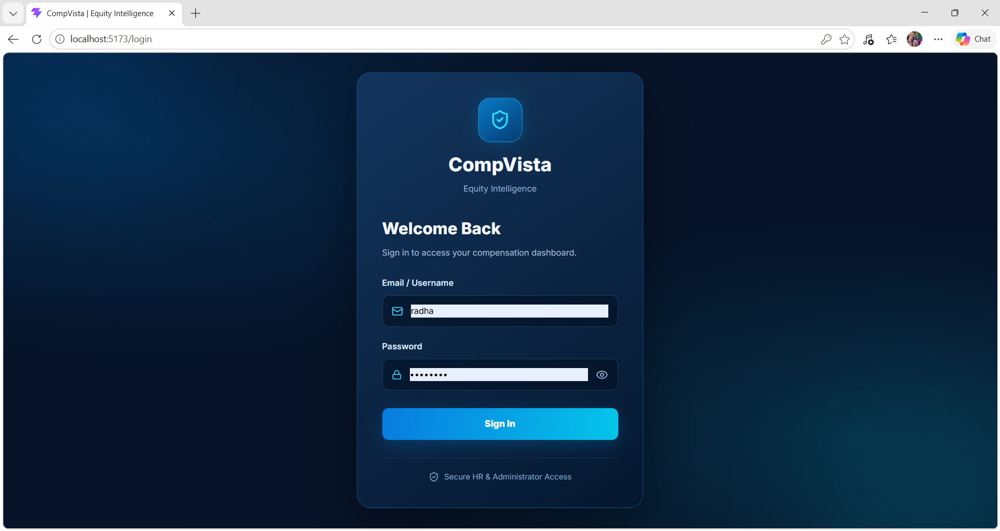

The login page is the entry point for authorized users. Authentication is handled by the Flask backend.

### 2. Dashboard

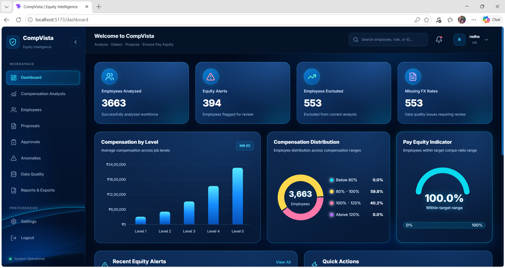

The dashboard summarizes the current compensation analysis, equity alerts, excluded employees, and missing FX-rate records. It also provides navigation to the main modules and quick actions.

### 3. Compensation analysis

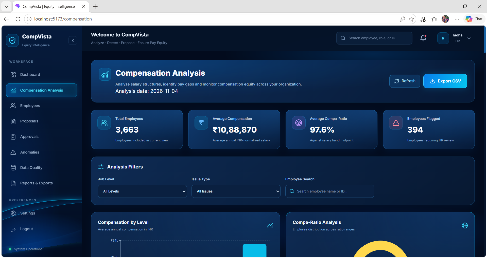

This page presents compensation metrics, analysis filters, compensation-by-level charts, compa-ratio distribution, and employee-level compensation results. Monetary values are displayed in Indian Rupees (INR).

### 4. Employee management

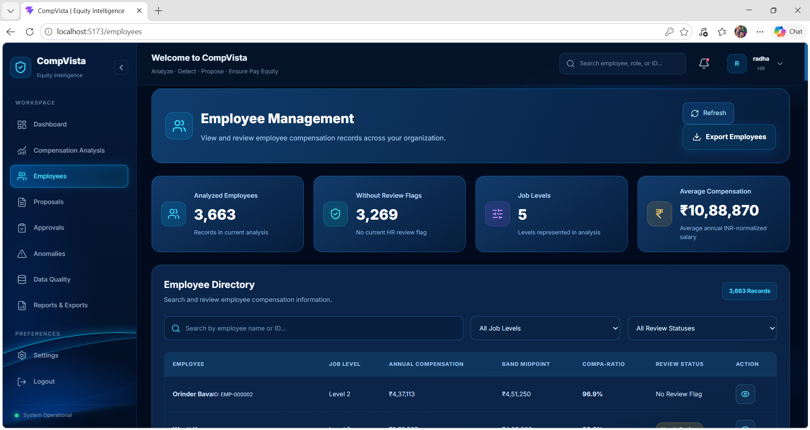

The employee directory supports searching and reviewing employees included in the current analysis. Summary cards provide workforce and compensation context.

### 5. Employee compensation details

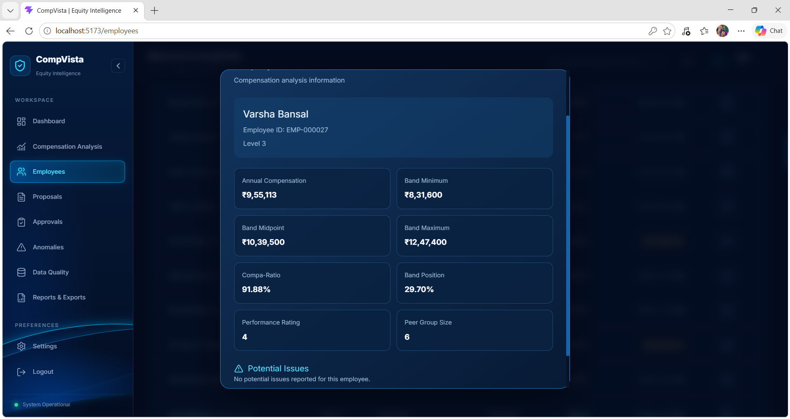

The detail view presents an employee's annual compensation, band minimum/midpoint/maximum, compa-ratio, band position, performance rating, peer-group size, and reported potential issues.

### 6. Compensation proposals

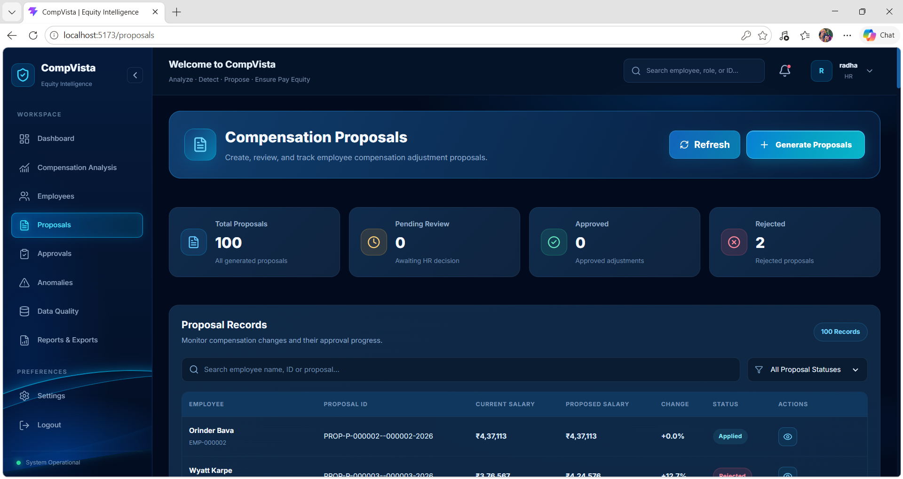

The proposals page lists generated adjustment proposals, current and proposed salary values, percentage changes, and workflow statuses.

### 7. Submit a proposal

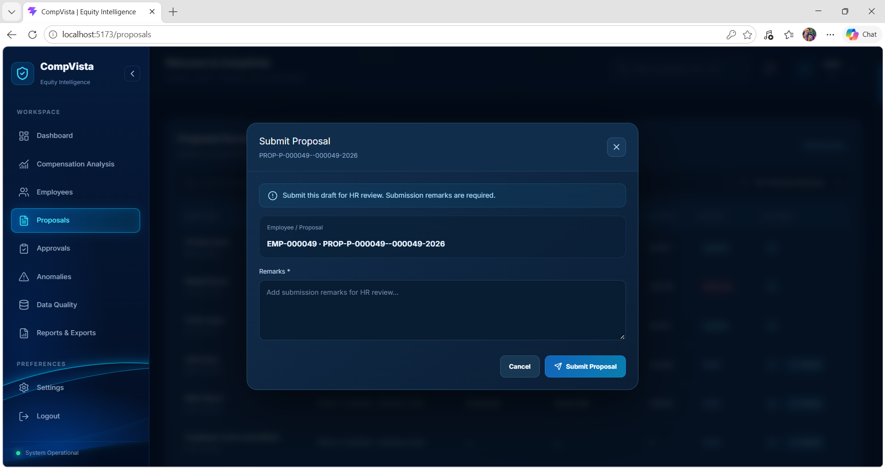

A draft proposal can be submitted for HR review. The submission dialog requires remarks so the reason for review is recorded with the request.

### 8. Approval management

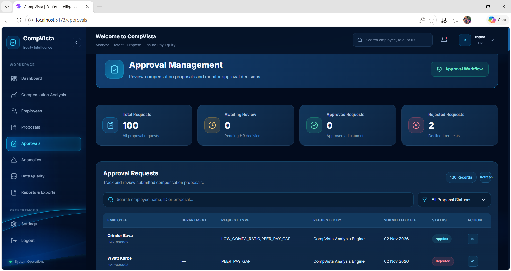

The approvals page provides a consolidated view of proposal requests, request types, submission dates, and current statuses. Authorized reviewers can inspect requests and take the actions enabled by the workflow.

### 9. Anomaly detection

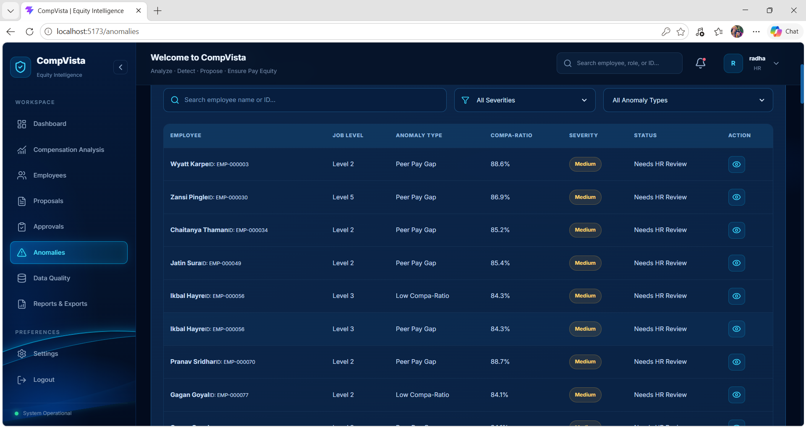

The anomaly view lists potential compensation issues with employee, job level, issue type, compa-ratio, severity, and review status. These are indicators for investigation, not final findings.

### 10. Data quality monitoring

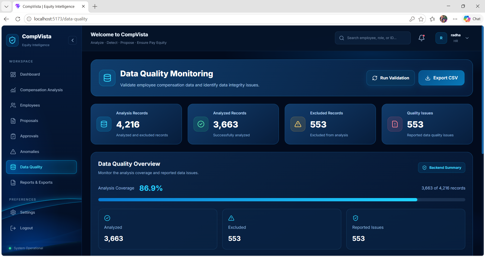

The data-quality page separates analyzed and excluded records, reports analysis coverage, and identifies categories responsible for exclusions. In the captured run, 553 records were excluded because an applicable FX rate was unavailable.

### 11. Reports and exports

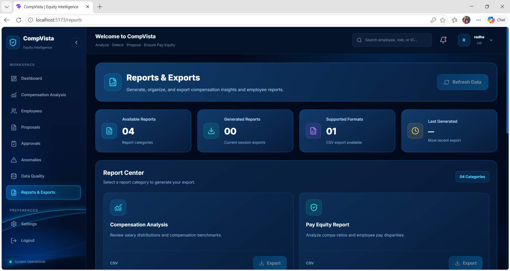

The report center offers CSV exports for available report categories and displays export activity for the current browser session.

### 12. Settings

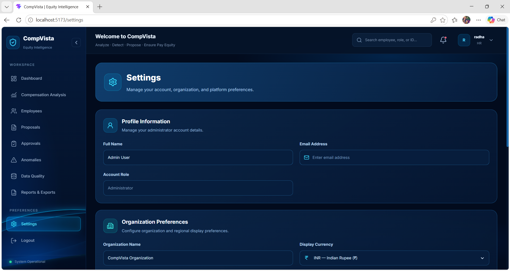

Settings include profile information, organization display preferences, notification preferences, and account-security information. Browser-local preferences are saved in `localStorage`.

## Example figures from the captured run

The following values are transcribed from the supplied screenshots. They describe that particular local dataset and analysis run; they are not guaranteed values for every fresh installation.

| Metric | Captured value |
|---|---:|
| Records considered by data-quality monitoring | 4,216 |
| Employees included in the current analysis | 3,663 |
| Records excluded from analysis | 553 |
| Analysis coverage | 86.9% |
| Employees flagged for HR review | 394 |
| Anomaly records shown | 499 |
| Missing FX-rate records | 553 |

**Interpretation:** The 553 missing-FX records are excluded from the current compensation analysis because an applicable conversion rate is unavailable. The 499 anomaly count represents issue records and can include more than one issue for an employee; it is not a count of unique employees. The 394 flagged figure is the number of unique employees shown as requiring review in the captured view.

## Verification commands

Run these from the repository root with the Python virtual environment activated.

### Backend regression tests

```powershell
python -m pytest tests -q
```

Pytest prints the number of passed, failed, or skipped tests. Review the actual result from the current checkout rather than relying on a result recorded for an earlier code version.

### Data validation scripts

```powershell
python src/verify_bands.py
python src/verify_data.py
```

These standalone validation scripts are separate from the pytest suite.

### Backend health check

With the backend running, open:

```text
http://127.0.0.1:5000/health
```

If this route is unavailable in the checked-out version, inspect the backend startup output and route definitions under `backend/`.

## Troubleshooting

### A. `python` is not recognized

Check whether the Python launcher is available:

```powershell
py --version
```

If it is, create the environment with:

```powershell
py -m venv venv
.\venv\Scripts\Activate.ps1
py -m pip install -r requirements.txt
```

If neither `python` nor `py` is available, install Python and reopen PowerShell.

### B. PowerShell blocks virtual-environment activation

```powershell
Set-ExecutionPolicy -Scope Process -ExecutionPolicy Bypass
.\venv\Scripts\Activate.ps1
```

This changes the policy only for the current PowerShell process.

### C. `ModuleNotFoundError` or missing Python package

Confirm that the virtual environment is active. Then run:

```powershell
python -m pip install -r requirements.txt
```

If installation still fails, note the exact package name and full error message. Avoid installing arbitrary package versions without checking the dependency file.

### D. `JWT_SECRET_KEY` / HS256 secret-key error

This means the backend process does not have a JWT signing secret configured.

Stop the backend with `Ctrl + C`. In the **backend PowerShell terminal**, run:

```powershell
$env:JWT_SECRET_KEY = python -c "import secrets; print(secrets.token_hex(32))"
python backend/app.py
```

Keep this terminal open. The environment variable must be set in the same terminal process that starts Flask.

### E. Login says `Invalid email or password`

Check the following in order:

1. Confirm that the backend terminal is still running.
2. Confirm that the username/email and password belong to an account in the database currently used by the backend.
3. Confirm that the database path points to the intended populated database, not a newly created empty SQLite file.
4. If separate reviewer credentials were supplied by the project owner, use those exact credentials.

A JWT secret fixes token-signing configuration; it does **not** create a user or reset a password. Do not guess credentials or edit password hashes manually.

### F. Login returns HTTP 500 / Internal Server Error

Check the **backend terminal** immediately after the failed login. The Python traceback there contains the actual cause.

For a JWT secret error, follow [Troubleshooting D](#d-jwt_secret_key--hs256-secret-key-error). For database/table errors, verify the configured SQLite file and whether the required schema and seed data are present. Do not delete the database or run migrations as a first response.

### G. Dashboard opens but shows zero employees or empty tables

The backend may have created an empty SQLite database. `db.create_all()` creates missing tables; it does not automatically load the synthetic dataset.

Check that the configured database file is the intended populated database and that synthetic data preparation has been completed. Do not copy a random test database over the current database.

### H. Frontend cannot connect to the backend

- Keep the Flask backend terminal running.
- Check `http://127.0.0.1:5000/health` if the health route is available.
- Check the browser developer console and Network tab for the failing API request.
- Review the frontend API base URL configuration in the API client under `frontend/src/`.
- Restart the Vite development server after changing frontend environment configuration.

### I. `npm run dev` fails

From the `frontend` folder, run:

```powershell
npm install
npm run
```

`npm run` lists the scripts available in that checkout. Start the development server using the `dev` script if it is present.

### J. Port 5173 or 5000 is already in use

Close the other development-server process using that port, then restart the corresponding server. Do not terminate unrelated processes.

## Data, security, and operational notes

- The application is intended for synthetic demonstration data. Do not upload real employee salary or personal data to a public repository.
- Do not commit `.env`, passwords, JWT secrets, local database files, `venv/`, `node_modules/`, or generated build output.
- The repository `.gitignore` should exclude at least `venv/`, `**/venv/`, `node_modules/`, `.env`, and local database files.
- Before pushing changes, inspect `git status` and review staged files. Do not blindly stage every untracked file.
- Keep a backup before any database migration or data modification.
- Migration and one-off test scripts are not part of normal application startup. Review their database target before running them.
- Settings stored in browser `localStorage` remain local to that browser profile.

## Scope and interpretation

CompVista is a decision-support demonstration. Compensation ratios, peer comparisons, and anomaly flags depend on data availability, data quality, comparison-group definitions, and the analysis date. A flag should initiate a documented human review; it should not be treated as a definitive conclusion or an automatic recommendation to change an employee's pay.
