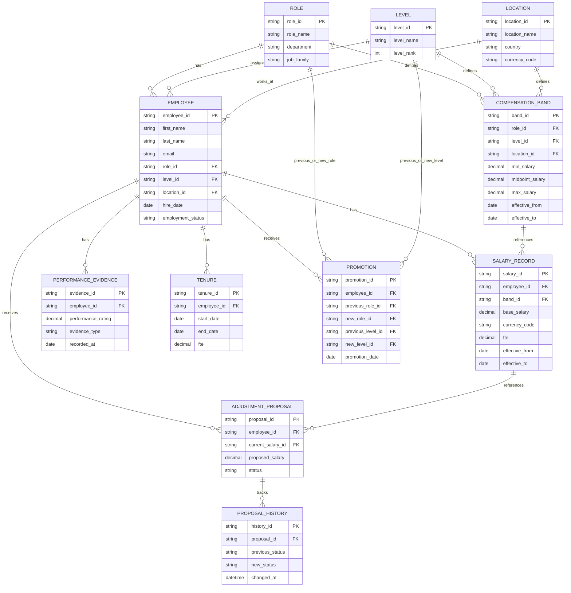

# CompVista - Entity Relationship Diagram

This diagram represents the database entities and their relationships.

## Additional Entity

AUDIT_LOG stores system-wide changes. It uses entity_type and entity_id to identify the affected record, so it is not represented as a conventional foreign-key relationship in this diagram.
